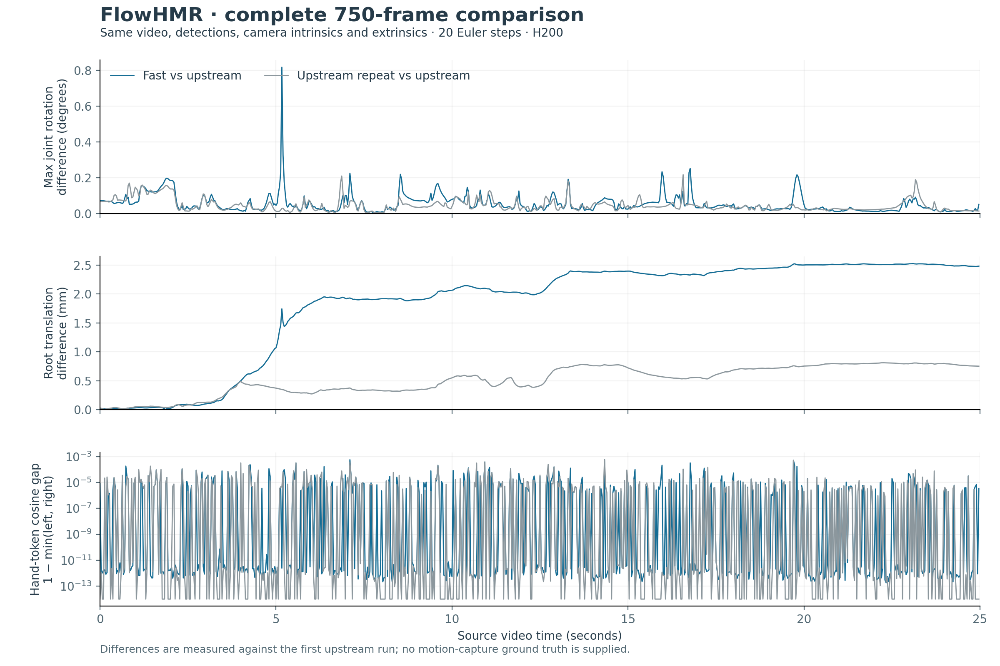

# Native Fast SAM integration — full 750-frame validation

Motius 0.3.7 implements GPU image preprocessing and one merged left/right hand
network pass in the unified FlowHMR pipeline. Every frame retains its original
body-first-pass, left-hand and right-hand conditioning tokens. VGGT still
processes all 750 frames, at interval 1.

## Implementation and scope

The implementation follows the GPU preprocessing and hand-batching design of
[Fast-SAM-3D-Body](https://github.com/yangtiming/Fast-SAM-3D-Body/tree/d72aa36913a1673ace029d345f437561a85ec9e2),
with its MIT notice preserved. Neural networks and weights remain the original
SAM/DINO implementations in native vision bundles. GPU preprocessing and
inference orchestration live in `motius/pipelines/flowhmr/sam`; no Fast source
tree is vendored or imported at runtime.

For each frame, the frontend:

1. Uploads uint8 RGB pixels once, crops the body on GPU and runs the original
   body network. It captures the first body token, not the prompted final token.
2. Uses the original body-predicted hand boxes. The left image and box are flipped
   using the original width-minus-coordinate-minus-one convention.
3. Crops and normalizes both hands on GPU, merges the person axis in
   `[all left, all right]` order, and runs one hand backbone/decoder batch.
4. Splits the result back into the original left/right ordering and concatenates
   the three actual tokens into 3072 dimensions. It stops before unused final
   wrist fusion/prompt processing.

Intermediate pose/mesh predictions that condition subsequent decoder layers are
retained. There are no average hand features, skipped hand observations, changed
hand detectors, reduced decoder depth or fewer motion-sampling steps.

The image warp reproduces OpenCV's 10-bit inverse-coordinate rounding, 5-bit
bilinear interpolation table, zero border and uint8 output rounding. Smooth
floating-point `grid_sample` would change the input pixels and is deliberately
not used as a drop-in replacement. Small affine metadata is calculated on CPU
with the original crop geometry; RGB warp, flip, scaling and normalization run
on GPU. Known uint8/255 bounds avoid repeated GPU-to-CPU scalar range checks.

## Independent reference

The reference is executed from clean, external source checkouts:

| Component | Revision |
| --- | --- |
| FlowHMR | `f12e6a2d46a63d771a66dbb6b5598a1be65b9eea` |
| SAM-3D-Body | `b5c765a0d89d789985e186d396315e7590887b94` |
| DINOv3 | `6876159a11b4df116f30f667f8c9888617df0751` |
| VGGT-Omega | `48b23c8ce72c9a8fcf987f0d7f43d8e4870759f6` |

Original SAM/YOLOX/VGGT functions and the original `V2MPipeline.generate` are
used, not a monkeypatched native implementation. The original pipeline loads
the same exported learned weights/statistics, with strict coverage checks;
licensed body assets are supplied separately. The DINO Torch Hub cache is
populated from the pinned clean checkout, avoiding a moving remote `main`.

## Conditions

The user's original 1280×720, 30 fps, 750-frame video has SHA-256
`8f9e9c1193163940eafb512e9a0621a31fe316406e7a69aa3a357f6deceb17f1`.
Both transcodes have SHA-256
`2876966b39bb0d5f04c02a6a382dc0649d3cfed2477e4cb69785263b6bc41bc7`.
All 750 detection boxes, camera intrinsics and camera extrinsics match bit for
bit. Tracking interpolates the same 15 missing detections on both sides; SAM
still processes those actual video frames.

Hardware/software: one H200, Torch `2.6.0a0+ecf3bae40a.nv25.01`, four CPU threads,
FP32 motion sampling with TF32 disabled, original frontend precision, 20 Euler
steps, seed 0 and CFG 1. Both variants start fresh processes, reload all models
and recompute detection, camera and body/hand features. Files/kernel disk caches
are warm; downloads are excluded. An idle service retains about 1.5 GiB on the
GPU and is never stopped. Guards yield if other CUDA work or resident-service
CPU activity appears. This is an available-container benchmark, not a consumer
GPU or isolated whole-host benchmark.

Motion postprocessing is disabled on both sides; the same first-frame mesh floor
alignment and 52-joint FK are applied. Blender mesh import, retargeting, grounding
and playback preparation are excluded from these backend timings.

## Measured runtime and memory

| Metric | Original source | Native Fast |
| --- | ---: | ---: |
| Full pipeline, including model loads | 413.60 s | 253.94 s |
| SAM extraction, all 750 frames, excluding model load | 304.05 s | 163.88 s |
| SAM frame mean, first five warm-up frames excluded | 401.92 ms | 215.46 ms |
| SAM frame p95, first five warm-up frames excluded | 475.53 ms | 226.41 ms |
| Peak allocated CUDA memory | 39.98 GiB | 27.80 GiB |
| Peak reserved CUDA memory | 59.49 GiB | 47.29 GiB |

This pair is **1.63× faster overall** and **1.86× faster in SAM extraction**.
The pipeline timer starts after interpreter/Torch startup, CUDA initialization
and validation-only input/checkpoint hashing. These setup/audit steps are excluded;
`process_seconds` is also preserved but includes audit reads.
The full pipeline timings include network warm-up; excluding five frames applies only to the
explicitly labelled per-frame statistics. These are full real-video runs, not
sampling-only tests with repeated or cached features. Individual full-run
measurements do not establish throughput averages or consumer-card performance.
Peak allocated/reserved values are PyTorch process statistics; CUDA contexts,
other libraries and the resident service require additional memory.

This is a whole-pipeline comparison: existing meta-loading, camera-only VGGT
and sequential-residency optimizations also contribute. The entire latency and
memory reduction must not be attributed to hand batching alone. The previous
partial native path measured 365.89 seconds on this clip in the earlier 0.3.6
experiment; that historical single run is not the paired reference for the
speedup above.

The camera phase still dominates peak memory. The 25-second clip still takes
about 4 minutes 14 seconds and uses 27.80 GiB allocated memory, so this is not
real-time inference or evidence that the full clip fits an 8/12/24 GB GPU.

## Full-video reproduction differences

Every result is finite and contains all 750 frames, 3072 conditioning dimensions
per frame, 52 local joint rotations and 52 FK joint positions.

| Comparison against original source | Measured difference |
| --- | ---: |
| Body token minimum cosine | 0.99999999999932 |
| Body token maximum absolute difference | 3.81e-6 |
| Left-hand token minimum / mean cosine | 0.999429 / 0.999995 |
| Right-hand token minimum / mean cosine | 0.999438 / 0.999992 |
| Local joint rotation, mean / p99 / maximum | 0.0112° / 0.0870° / 0.8172° |
| Body rotation maximum | 0.8172° |
| Left-hand rotation maximum | 0.3333° |
| Right-hand rotation maximum | 0.2419° |
| Root translation, mean / maximum | 1.836 / 2.526 mm |
| All 52 joints, position difference mean / maximum | 1.847 / 5.319 mm |

These are agreement measurements against the original output, not accuracy
against motion-capture ground truth. **The result is not bitwise identical and
must not be described as universally lossless.** In particular, the worst hand
token cosine is below the issue author's 0.9999 heuristic; the high mean does not
make that worst case disappear. Fast has 8 left-hand and 15 right-hand frames
below that threshold; the full original repeat also has 6 and 12 such frames,
with minimum cosines 0.999429 and 0.999497 respectively. The smaller five-frame gate did not cover these
outliers, which is why the complete clip was measured.

The worst-frame diagnostic evaluates the same upstream neural model with both
frontends, repeats original inference, and freezes the original hand boxes.
With fixed original hand boxes, hand-token cosine in all eight checked worst
frames exceeds 0.99999999996. Recomputed boxes can differ after small upstream
floating-point perturbations; the original implementation itself also exhibits
this behavior. The per-frame diagnostic is preserved rather than treating a
batching/preprocessing bug as an unexplained rounding allowance.

### Independent sampler replay and original-run variability

Using the exact same original features, re-executing the original generator
reproduces its first output bit for bit. Using Fast's features and camera input,
the original generator and the native lightweight sampler differ by at most
**0.0000276°** local rotation, **0.000523 mm** root translation and **0.000777 mm**
FK joint position. The larger full-video differences therefore arise upstream
of motion sampling, rather than from an incorrect native network/ODE/decoder
implementation.

A second complete original run also recomputes all 750 detections, camera
observations and SAM features. Its observations match the first original run
bit for bit, while final local rotations differ by up to **0.2161°**, root
translation by **0.8118 mm**, and all-joint positions by **1.2159 mm**. Fast's
maximum errors are larger than this measured original-run variability; they
are **not** claimed to be entirely covered by a numerical noise floor.

The original repeat took **438.50 seconds**, including **334.10 seconds** of SAM
extraction, versus 413.60 / 304.05 seconds in the first run. This documents
available-container timing variability. The speedup table uses the first
back-to-back reference/Fast pair; the slower original repeat is not substituted
to inflate the advertised gain. Only one complete Fast timing is available.



## Selection and reproduction

```bash
# Complete Fast frontend plus lightweight motion attention/residency.
python tools/infer_flowhmr.py input.mp4 --lightweight --sam-backend fast --profile

# Full original SAM execution, retaining the other lightweight resource controls.
python tools/infer_flowhmr.py input.mp4 --lightweight --sam-backend official --profile
```

Python accepts `sam_backend='auto'|'official'|'fast'`. `auto` chooses Fast with
`lightweight=True` and original SAM otherwise. Explicit Fast keeps the original
network, weights and every-frame body/hand features. The Blender 0.2.3 lightweight
mode explicitly selects Fast and rejects backends without this capability.

The standalone validation worker accepts explicit reference checkout, checkpoint,
body-model, regressor, frontend-path JSON, input video, output and variant:

```bash
python tools/validate_flowhmr_fast_sam.py \
  --upstream /path/to/FlowHMR --checkpoint /path/to/native-latest \
  --body-model /path/to/smplh/neutral/model.npz \
  --j-regressor /path/to/smpl_neutral_J_regressor.pt \
  --assets /path/to/frontend_paths.json \
  --video assets/model_zoo/flowhmr/demo_input.mp4 \
  --frames 750 --variant upstream --output /path/to/case/upstream
# Repeat with --variant fast --output /path/to/case/fast.
python tools/compare_flowhmr_fast_sam.py /path/to/case
```

The frontend JSON maps the same five explicit SAM/config/MHR/VGGT/YOLOX paths
used by the latency profiling tools. Independent original-sampler replay and
worst-frame diagnostic tools accompany the worker. Measured JSON, per-frame
statistics and source/weight fingerprints accompany this report.

## Delivered evidence and checks

The [machine-readable validation record](flowhmr-fast-sam-20261026.json) includes
all run timings, per-frame errors, token distributions, source/weight fingerprints,
original-sampler replay, worst-frame diagnostics and original-repeat controls.
The [editable error plot](flowhmr-fast-sam-20261026.svg) accompanies the PNG.

Local measured artifacts are under
`outputs/validation/flowhmr/fast-sam-20261026/`: `fast/result.npz`,
`upstream/result.npz` and `upstream-repeat/result.npz` are schema-validated Motius
captures with all 750 frames and all 52 body/hand rotations. Each was loaded back
and checked against its measured rotation arrays.
`flowhmr-fast-sam-750frames.zip` contains those captures, per-frame CSV errors,
validation JSON, diagnostics and checksums. `results.tar.gz` preserves the full
feature/pose/input arrays received from the GPU container, verified by SHA-256.
No model weights or body-model assets are included in these motion artifacts.

Validation: **68 tests passed, one skipped**; the production Fast CLI ran on GPU
and recorded `sam_backend=fast`, complete hand features and camera interval 1.
Both Blender 0.2.3 archives passed Blender 4.5.3 extension validation.
All benchmark/diagnostic processes exited; the pre-existing idle service remains
running. No GPU container was requested or stopped.
