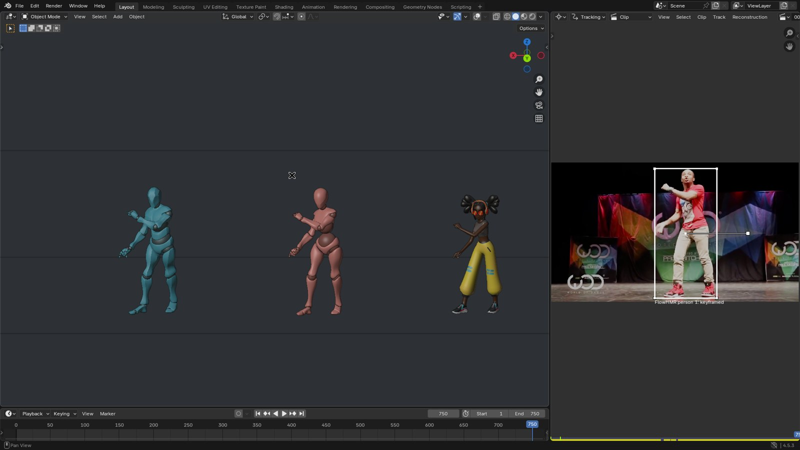
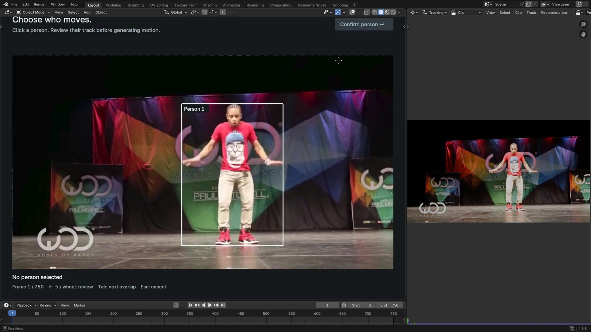

# FlowHMR for Blender

Turn a video into a 52-joint body and hand capture, then retarget and ground it on Mixamo characters inside Blender. Standard and Lightweight inference are two choices in **one extension**.

[Watch the complete Blender workflow](assets/demo.mp4) · [Download the extension ZIP](https://github.com/ZeyuLing/Motius/raw/main/docs/flowhmr-blender/motius-flowhmr-0.2.12.zip)

The video shows the capture result followed by selecting the video and person, inference, retargeting and grounding. It was recorded with an earlier interface; the labels and options below describe the current extension.

## Requirements

- Blender 4.2 or newer and a 64-bit Linux or Windows machine with an NVIDIA CUDA GPU and a compatible driver. The full workflow has been tested on **Linux / H200**. Windows support has code-level tests only; Windows and consumer GPUs still need physical validation. macOS and AMD GPUs are not supported by this CUDA backend.
- Internet access for the initial one-click setup and enough free disk space for Python, CUDA packages, approximately **9.66 GB of model files**, and caches. FFmpeg and FFprobe are installed and verified if missing.
- An authorized **neutral SMPL-H `.npz`** model with 52 joints and 16 shape coefficients. This model is not included in the ZIP or downloaded automatically. Obtain it under its original license; male or female models are not substitutes.
- One or more editable standard Mixamo T-pose characters for retargeting. The extension does not supply character meshes or rigging.

## Installation

1. Download the ZIP above. In Blender, open **Edit → Preferences → Get Extensions → Install from Disk…**, select the ZIP and enable the extension.
2. Enable Blender's online access. Open the 3D Viewport sidebar (**N → FlowHMR**) and select your neutral SMPL-H model.
3. Click **Install / update runtime**. The extension installs a separate Python environment, CUDA PyTorch, dependencies and pinned model weights. Progress shows the current stage, package and actual weight-download bytes. Blender remains usable; reopening it can reconnect to an ongoing install.
4. Click **Check environment**. GPU, TorchVision, model files, SMPL-H and video tools are checked before inference. Keep the NVIDIA driver up to date. The installer does not install packages into Blender's own Python.

The runtime is stored under `~/.cache/motius/flowhmr-runtime` by default. To use a different folder or your own Python environment, open **Options → Backend setup**; save Blender preferences after changing the runtime folder. An interrupted model download can reuse its cache.

## Capture and animate

1. Select a video under **Your performance** and click **Preview**, then **Detect people**. Click **Choose person**, select a detected box and check the track before confirming. In overlapping boxes, use Tab or click again to cycle candidates.
2. Select **Standard** or **Lightweight** in the same panel and click **Add capture to queue**. Both modes preserve per-frame body and hand features and process every camera frame at the default camera interval. Lightweight uses GPU preprocessing and batches both hands.
3. Continue editing or queue additional videos while inference runs. The queue displays real stages and progress; select **Import result** once the job finishes. Failed and interrupted jobs can be retried, and memory-related retries reduce working batch sizes rather than frames or selected precision.
4. Import your Mixamo character, select it, and use **Apply motion to character** followed by **Plant feet on the floor**. For multiple characters, use **Animate and ground all characters**. **Prepare & play at original speed** prepares a view for real-time playback.

The tracker can lose identity through occlusion or crossings; inspect the selected track. Ground contact is an estimate and should be reviewed for the character and action. The extension supports standard editable Mixamo rigs; constrained control rigs and nonuniformly scaled rigs require preparation.

## Measured performance

The measurements below use the supplied **750-frame, 30 fps video**, a single NVIDIA H200, 20 sampling steps, every camera frame, and per-frame body and hand features. Times include model loading and computation, but exclude user actions. The memory numbers are the inference process's sampled driver peaks, not a minimum GPU requirement. These are single-run observations on one server, not Windows or consumer-GPU benchmarks.

| Mode and measurement | Time | GPU memory |
| --- | ---: | ---: |
| Standard, upstream frontend precision | 108.64 s | 5.11 GiB |
| Lightweight, upstream frontend precision | 96.43 s | 6.28 GiB |

The rows come from separate measurements with different optimization configurations and are not a controlled head-to-head guarantee. Batch sizes, attention kernels and mixed precision may change numerical results. The upstream default uses BF16 where supported; FP16 and strict FP32 frontend options are explicit alternatives. An older GPU that cannot execute the selected precision is rejected rather than silently changing it. Available VRAM is checked and workspace batches are adjusted; very long videos or competing applications can still run out of memory.

See the [standard benchmark](../architecture/validation/flowhmr-shared-standard-20261027.md), [Lightweight measurement](../architecture/validation/flowhmr-productization-20261027.md), and [native installer validation](../architecture/validation/flowhmr-blender-native-installer-20261027.md) for methodology, precision and limitations.

## Licenses and attribution

The extension is GPL-3.0-or-later. FlowHMR weights, SMPL-H, tracking models and Mixamo characters have their own licenses; FlowHMR has education/research/nonprofit restrictions. See the extension's `NOTICE.md`. The workflow is informed by [Motion2MixamoRig](https://github.com/MaxLiu22/Motion2MixamoRig) and [FlowHMR issue #4](https://github.com/flowhmr/flowhmr/issues/4).
